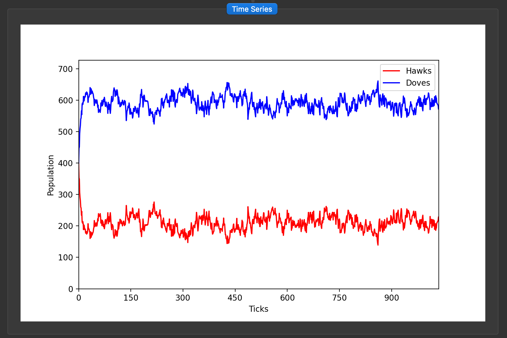

## The World:
- A tile-based isometric world grid (configurable size) with "open" and "rock" tiles. Unlike the Lotka-Volterra world, the edges do not wrap.
- Each "open" tile holds at most one individual, which is either a Hawk or a Dove.
- "Rocks" are impassable and never hold individuals (and are added to the world via Perlin noise).

## The Model:
- A spatial, agent-based version of the classic Hawk-Dove game from evolutionary game theory. Individuals compete over a resource of value `V` using either an aggressive (Hawk) or a passive (Dove) strategy, and fighting has a cost `C`.
- The classic model assumes a well-mixed population where anyone can meet anyone. Here, individuals only play their 8 surrounding neighbours and only copy strategies from them, so strategies form clusters and success depends on the local neighbourhood.
- When `C > V`, neither pure strategy is stable. Hawks do well when rare but pay the cost of fighting each other when common. In the well-mixed game this leads to a mixed ESS with a Hawk frequency of `V / C`. The spatial version can deviate from this.

## Payoffs:

| Focal \ Opponent | Hawk | Dove |
|------------------|------|------|
| **Hawk** | (V − C) / 2 | V |
| **Dove** | 0 | V / 2 |

## Time-Series Plot:

## The Rules:
Each generation has three steps:
- **Move:** each individual moves one tile in a random cardinal direction, if that tile is empty and not a rock. Otherwise it stays put.
- **Play:** each individual plays a set number of games (games per individual), each against a randomly chosen neighbour. The payoffs are summed into the individual's score. Individuals with no neighbours score 0.
- **Reproduce:** each tile is refilled by copying the strategy of one candidate: the current occupant or one of its neighbours. A candidate is chosen with probability proportional to `exp(score / T)`, where `T` is the selection temperature, so higher-scoring candidates are more likely to be copied.

## Notes on the Dynamics:
- Only the strategy is inherited. The offspring stays on the original tile, and score and position are not passed on.
- The population size is constant. Every individual is replaced by exactly one offspring, so this is imitation dynamics rather than birth and death.
- There is no mutation. A strategy that disappears from the whole grid cannot return.
- The selection temperature sets how strongly score matters. A low value gives near-deterministic "copy the best neighbour", and a high value gives near-random drift. It should be on the same scale as the payoffs (`V`, `C` and games per individual), otherwise selection sits at one of the extremes.