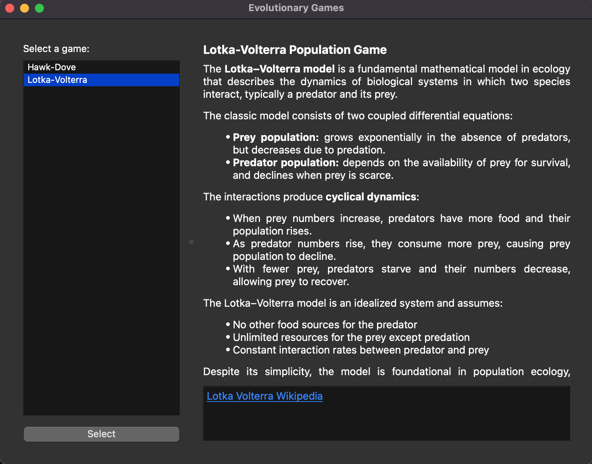
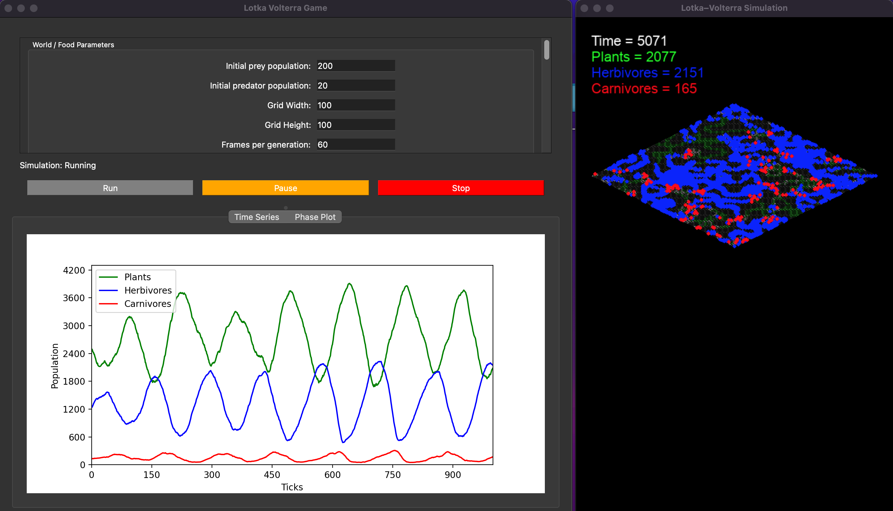
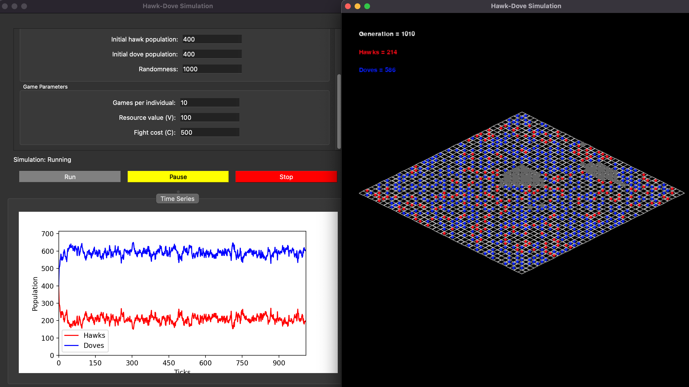

# Evolutionary Games

A PySide6 desktop app that houses interactive **ecology and evolutionary biology (EEB) "games"**: small, parametrizable simulations for exploring core concepts in the field. Pick a game from the launcher, set its parameters, run the simulation, and watch the dynamics unfold through live plots and a real-time visualization.

Inspired by [Theoertical Community Ecology Lab](https://stefanoallesina.github.io/Theoretical_Community_Ecology/)



## Games

| Game | Concept |
|------|---------|
| [Lotka-Volterra](#lotka-volterra-population-game) | Predator-prey population dynamics in a spatial, three-tier ecosystem |
| [Hawk-Dove](#hawk-dove-game) | Evolutionary game theory: conflict strategies and evolutionarily stable strategies (ESS) |
More "games" may be added over time.

## Getting Started

### Requirements

- Python 3.10+
- PySide6 (6.9)
- pygame-ce (2.5.6)
- matplotlib (3.10.8)
- numpy (2.2.4)

### Install

```bash
git clone https://github.com/aidanwobrien/eeb-simulations
cd eeb-simulations
pip install -r requirements.txt
```

### Run

```bash
python app.py
```

## Using the App

1. **Select a game** from the list on the left of the launcher. A description of the model and a link to further reading appear on the right.
2. Click **Select** to open that game's simulation window.
3. Adjust parameters, then use the controls to run the simulation:
   - **Run** starts the simulation.
   - **Pause** freezes it so you can inspect the current state.
   - **Stop** ends the run.
4. Watch the results in the live plots and the visualization window.

---

## Lotka-Volterra Population Game



The Lotka-Volterra (LV) equations are a foundational model in ecology describing how two interacting species, a predator and its prey, change in abundance over time. This simulation implements an agent-based, spatial version of the model and extends it to a three-tiered ecosystem of plants, herbivores and carnivores.

### The World

- A toroidal (wrapping), tile-based isometric grid. The size is configurable (width and height).
- Tiles are either **empty** or **rock**.
  - Empty tiles can contain plants, herbivores and carnivores.
  - Rocks are impassable and are generated with Perlin noise.

### The Model

- The main goal was to build a 3-tiered ecosystem whose populations cycle through time in a stable phase, without any population crashing.
- The classic LV equations ignore space: the populations are effectively "well-mixed" every tick. In this model, movement costs, localized reproduction and impassable rocks introduce clustering, refuges and overall spatiality, and therefore more noise than the classic equations produce.

### The Rules

- Plant tiles produce food (energy).
- Each tick, **herbivores** move one space in a random direction. If they land on a plant tile, they eat it and gain energy. Once eaten, the plant is removed and regenerates after a fixed time (the regeneration rate).
- Each tick, **carnivores** move two spaces toward the closest herbivore. If they are on a tile with a herbivore, they eat it and gain energy. Carnivores must wait two ticks before eating again.
- Herbivores and carnivores **reproduce** when their energy reaches a reproduction threshold, at an energy cost (the reproduction cost). Offspring appear on a random unblocked neighbouring tile. If all neighbours are blocked, the animal does nothing that tick and keeps its energy.
- Herbivores and carnivores **lose energy** every tick (a basal cost) and with each movement (a movement cost).

### Parameters

The parameter panel (scrollable) controls the world and food settings, including:

| Parameter | Description |
|-----------|-------------|
| Initial prey population | Starting number of herbivores |
| Initial predator population | Starting number of carnivores |
| Grid width / height | Size of the world in tiles |
| Frames per generation | Number of rendered frames per simulation tick |

Further parameters (such as energy gains and costs, reproduction threshold and cost, and plant regeneration time) are available further down the panel.

<!-- TODO: list the remaining parameters and their defaults -->

### Visualization

- **Simulation window (pygame):** a real-time isometric view of the world with a live counter of the current time, plants, herbivores and carnivores. Herbivores are drawn in blue and carnivores in red.
- **Time Series plot:** population of plants, herbivores and carnivores against ticks.
- **Phase Plot:** the phase portrait of predator vs. prey abundance, where stable cycling appears as a closed orbit.

<!-- TODO: add screenshots of the Time Series and Phase Plot tabs -->

---

## Hawk-Dove Game



The Hawk-Dove game is a classic model from evolutionary game theory in which individuals compete over a resource using either an aggressive (Hawk) or a passive (Dove) strategy. This simulation is a spatial, agent-based version: individuals live on a grid, play only against their neighbours, and copy the strategies of successful neighbours over time. It is used to explore how strategy frequencies evolve and when a stable mixed strategy (ESS) emerges.

### The World

- A tile-based isometric grid. The size is configurable (width and height).
- Tiles are either **open** or **rock**.
  - Each open tile holds at most one individual.
  - Rocks are impassable, never hold individuals, and are generated with Perlin noise.
- Each individual is either a **Hawk** or a **Dove**. The initial numbers of each are placed on random open tiles.

### The Payoffs

When two individuals meet, they compete for a resource of value `V`. Fighting has a cost `C`.

| Focal \ Opponent | Hawk | Dove |
|------------------|------|------|
| **Hawk** | (V − C) / 2 | V |
| **Dove** | 0 | V / 2 |

When `C > V`, neither pure strategy is stable. Hawks do well when rare, but when common they mostly meet each other and pay the cost of fighting. In the well-mixed version of the game, this leads to a mixed ESS with a Hawk frequency of `V / C`. The spatial version can deviate from this, because neighbourhoods create clusters of each strategy.

### The Rules

Each generation consists of three steps:

1. **Move:** each individual moves one tile in a random cardinal direction, if that tile is empty and not a rock.
2. **Play:** each individual plays a set number of games (games per individual), each against a randomly chosen neighbour among the 8 surrounding tiles. Payoffs are summed into the individual's score. Individuals with no neighbours score 0.
3. **Reproduce:** each tile is refilled by copying the strategy of one candidate: the current occupant or one of its neighbours. Candidates are chosen with probability proportional to `exp(score / T)`, where `T` is the selection temperature, so higher-scoring candidates are more likely to be copied.

Notes on the dynamics:

- **Only the strategy is inherited.** The offspring takes the parent's phenotype, but stays on the original tile. Score and position are not passed on.
- **The population size is constant.** Every individual is replaced by exactly one offspring, so this is imitation dynamics rather than birth and death.
- **There is no mutation.** A strategy that disappears from the whole grid cannot return.
- **Selection temperature (randomness)** sets how strongly score matters. A low value means near-deterministic "copy the best neighbour". A high value means near-random drift. It should be on the same scale as your payoffs (`V`, `C` and games per individual), otherwise selection will sit at one of the extremes.

### Parameters

| Parameter | Description |
|-----------|-------------|
| Initial hawk population | Starting number of Hawks |
| Initial dove population | Starting number of Doves |
| Grid width / height | Size of the world in tiles |
| Games per individual | Number of games each individual plays per generation |
| Value (V) | Value of the contested resource |
| Cost (C) | Cost of losing a fight between two Hawks |
| Selection temperature | How strongly payoff influences who gets copied |
| Frames per generation | Number of rendered frames per generation |
| Perlin scale | Threshold that controls how much of the grid is rock |

### Visualization

- **Simulation window (pygame):** a real-time isometric view of the world with a live counter of the current generation, Hawks and Doves. Hawks are drawn in red, Doves in blue, and rocks in grey.
- **Time Series plot:** number of Hawks and Doves against generation.

## Project Structure

```
.
├── app.py              # App entry point / game launcher
├── games/
│   ├── lotka_volterra/  # Lotka-Volterra simulation
│   └── hawk_dove/       # Hawk-Dove simulation
├── mvc/                 # Qt views for each game (parameter panels, plot tabs)
├── docs/                # Screenshots
└── requirements.txt
```

## Further Reading

- [Lotka-Volterra equations (Wikipedia)](https://en.wikipedia.org/wiki/Lotka%E2%80%93Volterra_equations)
- [Hawk-dove game (Wikipedia)](https://en.wikipedia.org/wiki/Chicken_(game))